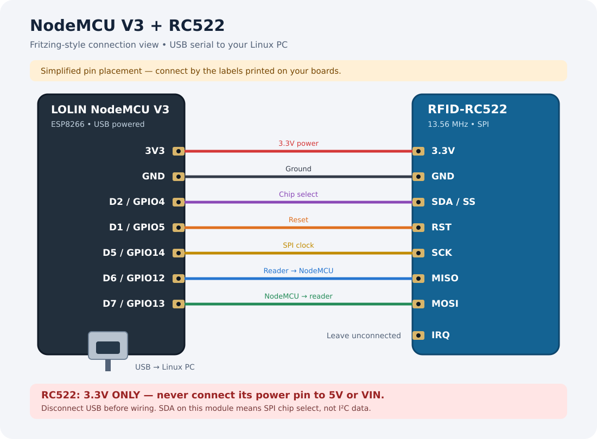

# Reviving the RFID PC Control Panel

This implementation uses a **LOLIN NodeMCU V3 (ESP8266)**, an **RC522** reader,
and a USB cable to a Linux computer. The NodeMCU sends card UIDs over serial.
The Python control panel approves one card and types your locally stored password,
then presses Enter using `ydotool`. No password is stored on the card or NodeMCU.
Changing the approved UID in the panel changes which card works; it does not rewrite the card.

## 1. Wiring (disconnect USB while wiring)



The diagram uses simplified pin placement. Match the **printed pin labels** on
your boards; the connections below match the firmware.

| RC522 label | NodeMCU label | GPIO |
| --- | --- | --- |
| 3.3V | 3V3 | — |
| GND | GND | — |
| SDA / SS | D2 | 4 |
| RST | D1 | 5 |
| SCK | D5 | 14 |
| MISO | D6 | 12 |
| MOSI | D7 | 13 |
| IRQ | Leave disconnected | — |

**Use 3.3V, never 5V, for the RC522.** Its SDA label is SPI chip select here.
Use a USB data cable, not a charge-only cable.

## 2. Flash the NodeMCU

In Arduino IDE:

1. Add `https://arduino.esp8266.com/stable/package_esp8266com_index.json` in
   Preferences → Additional Boards Manager URLs.
2. Install **esp8266 by ESP8266 Community** in Boards Manager.
3. Install **MFRC522 by GithubCommunity** in Library Manager.
4. Select **NodeMCU 1.0 (ESP-12E Module)** and the USB serial port.
5. Open `firmware/rfid_panel/rfid_panel.ino` and upload.
6. Close Serial Monitor before connecting the control panel.

Equivalent Arduino CLI commands:

```bash
arduino-cli core update-index --additional-urls https://arduino.esp8266.com/stable/package_esp8266com_index.json
arduino-cli core install esp8266:esp8266 --additional-urls https://arduino.esp8266.com/stable/package_esp8266com_index.json
arduino-cli lib install 'MFRC522@1.4.12'
arduino-cli compile --fqbn esp8266:esp8266:nodemcuv2 firmware/rfid_panel
arduino-cli upload --fqbn esp8266:esp8266:nodemcuv2 --port /dev/ttyUSB0 firmware/rfid_panel
```

## 3. Linux setup

Install Python 3, Tk, the Python venv module, and ydotool using your distro's package
manager. Debian/Ubuntu example:

```bash
sudo apt install python3-venv python3-tk ydotool
python3 -m venv .venv
.venv/bin/pip install -r requirements.txt
.venv/bin/python control_panel.py
```

On Arch, the corresponding packages include `python`, `tk`, and `ydotool`.
The `ydotoold` daemon must run and your account must have access to its socket.
Service names and socket locations differ by distribution: follow your installed
package's instructions. If required, set `YDOTOOL_SOCKET` to that socket before
launching the panel. Run the panel as your normal user, not root.

The serial port is usually `/dev/ttyUSB0`; `/dev/serial/by-id/...` is preferable
if available because it stays stable. You can enter that path directly in the panel.
If access is denied, grant your account serial access using your distro's serial
port group (often `dialout` on Debian/Ubuntu or `uucp` on Arch), then log in again.

## 4. Choose the card and password

1. Connect the NodeMCU and launch the panel.
2. Select or enter its serial port, then click **Connect / disconnect**.
3. Wait for **Connected**, click **Enroll next card**, and scan your card.
4. The approved UID fills automatically. You can also enter a UID manually.
5. Replace the literal **`password`** placeholder with your real password in the
   Password field. The app refuses to arm with the placeholder.
6. Click **Save settings**, then enable **Arm password typing + Enter**.
7. Focus an empty text field for a first test with a temporary, nonsecret password.
   Verify characters and Enter, then set your real password locally.
8. Focus the password field and scan your approved card. Remove it before scanning again.

To change cards, click **Enroll next card**, scan the replacement, save, and arm
again. Enrollment and field edits disarm typing. Each app launch starts disarmed.
The panel must remain open; there is no background service installed automatically.

## Practical limits

- The password types into whichever field has focus. The panel cannot identify a
  password field. Scanning does not clear an existing field or wake the computer.
- `ydotool` works through Linux virtual input, including Wayland, but requires its
  daemon. Its typing assumes a US keyboard mapping: first test every character
  with a nonsecret sample if you use another keyboard layout.
- A running user session and helper are required. This is not a standalone USB
  keyboard and does not provide cold-boot, disk-encryption, or BIOS password entry.
  Lock-screen behavior depends on the compositor and virtual-input permissions;
  test it locally before relying on it.
- Settings are at `$XDG_CONFIG_HOME/rfid-pc-panel/config.json`, defaulting to
  `~/.config/rfid-pc-panel/config.json`. The password is plaintext with file mode
  `0600`. Do not share this file. No real password is included in the source.
- Card UIDs can be copied; this is a convenience mechanism, not a strong second
  authentication factor. The reader needs a compatible 13.56 MHz card/tag.
- The firmware emits `CARD:<UID>` at 115200 baud. Serial Monitor must be closed
  while the panel is connected. There is a four-second typing cooldown.

Upstream references: [MFRC522 library](https://github.com/miguelbalboa/rfid),
[ESP8266 Arduino core](https://github.com/esp8266/Arduino), and
[ydotool](https://github.com/ReimuNotMoe/ydotool).
